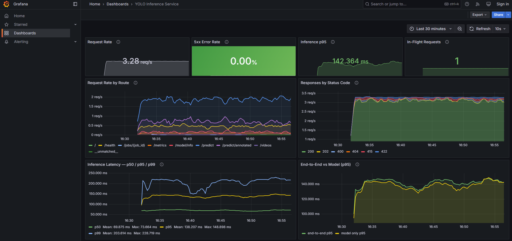
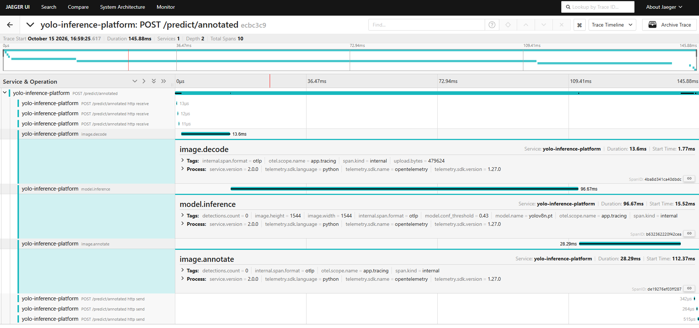
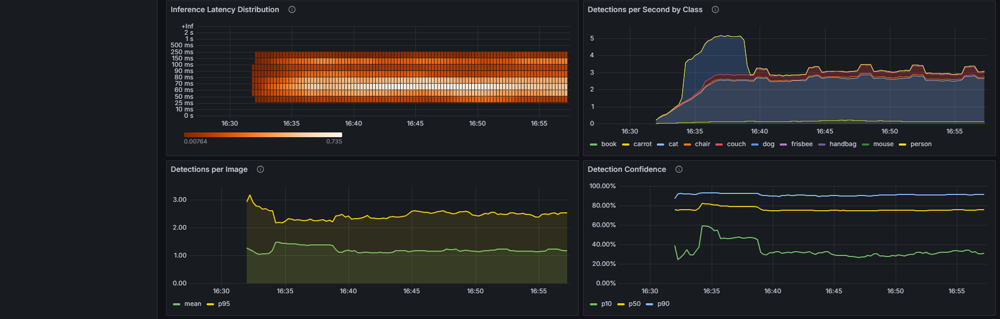
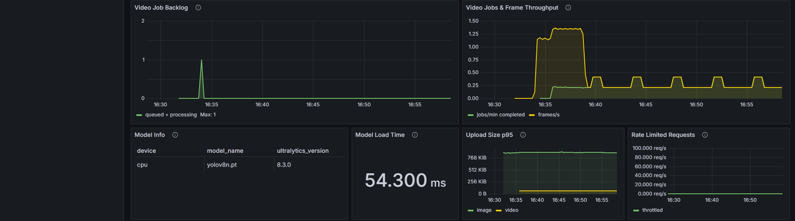
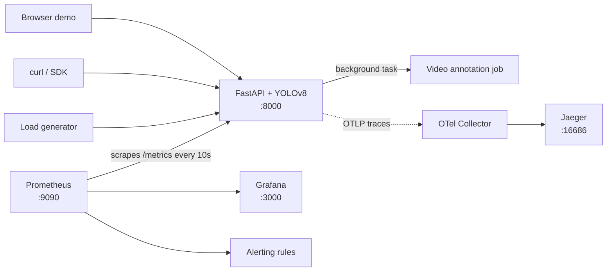

# YOLO Inference Platform

Production-shaped object detection as a service: **FastAPI + YOLOv8** with the
observability a real deployment needs — Prometheus metrics, a provisioned
Grafana dashboard, OpenTelemetry tracing through Jaeger, and alerting rules.

One command brings up the service, its monitoring stack, and enough synthetic
traffic to make the dashboards worth looking at.



<p align="center"><sub>RED metrics up top, latency percentiles below, and the end-to-end vs model-only split on the right.</sub></p>

A single request, broken down — the thing metrics alone cannot show you:



<p align="center"><sub><code>POST /predict/annotated</code>, 146 ms total: 13.6 ms decode, 96.7 ms inference, 28.3 ms annotate. That annotate span <em>is</em> the cost of this endpoint over <code>/predict</code> — no guessing required.</sub></p>

<details>
<summary><b>More panels</b> — latency distribution, detections by class, drift signals, async job health</summary>



<sub>The heatmap's y-axis is the custom bucket layout, and the bright band lands squarely in the 60–80 ms range the boundaries were measured for. With the library defaults every one of those samples would fall into a single bucket.</sub>



</details>

---

## Architecture



**Metrics are pulled, traces are pushed.** That split is the central design
decision here, and it is deliberate — see [Design decisions](#design-decisions).

---

## Quick start

```bash
# service + monitoring, quiet
docker compose up --build

# same, plus a load generator so the dashboards have data within 30s
docker compose --profile demo up --build
```

| URL | What |
|---|---|
| http://localhost:8000/ | Drag-and-drop web demo |
| http://localhost:8000/docs | Interactive OpenAPI docs |
| http://localhost:8000/metrics | Raw Prometheus metrics |
| http://localhost:3000 | Grafana dashboard (anonymous viewer access) |
| http://localhost:9090 | Prometheus — targets, PromQL, alerts |
| http://localhost:16686 | Jaeger — distributed traces |

The service also runs standalone, with no stack around it:

```bash
docker build -t yolo-inference .
docker run -d -p 8000:8000 yolo-inference
```

Metrics still work in that mode. Tracing switches itself off, because no
collector endpoint is configured.

---

## API

| Method | Path | Description |
|---|---|---|
| GET | `/` | Web demo: drag an image or video, boxes drawn on canvas |
| GET | `/health` | Liveness probe |
| GET | `/model/info` | Model name, class list, versions, device |
| POST | `/predict` | Detect objects in an image, returns JSON |
| POST | `/predict/annotated` | Same, returns the image with boxes drawn (JPEG) |
| POST | `/videos` | Submit a video for async annotation → `202` + job id |
| GET | `/jobs/{id}` | Job status and progress |
| GET | `/jobs/{id}/result` | Download the annotated video once complete |
| GET | `/metrics` | Prometheus exposition format |

All inference endpoints accept `conf`, `iou`, `classes` and `max_det` as query
parameters.

```bash
# JSON detections, only dogs above 0.4 confidence
curl -X POST "http://localhost:8000/predict?conf=0.4&classes=dog" -F "file=@image.jpg"

# Annotated image
curl -X POST "http://localhost:8000/predict/annotated" -F "file=@image.jpg" -o boxed.jpg

# Async video annotation
curl -X POST "http://localhost:8000/videos?conf=0.4" -F "file=@clip.mp4"
# -> {"job_id": "209a85d5b6bd", "status": "queued", "status_url": "/jobs/209a85d5b6bd"}
curl http://localhost:8000/jobs/209a85d5b6bd
curl -o annotated.mp4 http://localhost:8000/jobs/209a85d5b6bd/result
```

Every response carries a `request_id` (also in `X-Request-ID`), the model
version, inference time and image size. When tracing is on, the access log
also carries the `trace_id`, so a log line links straight to its trace.

---

## Metrics

15 metrics across three layers. The design rationale for each — including why
the histogram buckets are what they are — is in
[docs/metrics-design.md](docs/metrics-design.md).

### HTTP layer (RED)

| Metric | Type | Labels | Answers |
|---|---|---|---|
| `http_requests_total` | Counter | method, path, status | Traffic and error rate. Errors are `{status=~"5.."}` on this counter, not a second one that could drift out of sync |
| `http_request_duration_seconds` | Histogram | method, path | End-to-end latency distribution |
| `http_requests_in_flight` | Gauge | — | Concurrency. Latency percentiles cannot show queueing |
| `rate_limited_requests_total` | Counter | path | Is the limiter firing, and on what |
| `upload_size_bytes` | Histogram | kind | Payload sizes, including uploads we reject |

### Model layer

| Metric | Type | Labels | Answers |
|---|---|---|---|
| `inference_duration_seconds` | Histogram | source | Pure model time. Its gap from end-to-end latency *is* the decode + serialise cost |
| `detections_total` | Counter | class_name | What the model actually finds |
| `detections_per_image` | Histogram | — | **Drift sentinel.** 3–5 objects/image dropping to 0.2 means something upstream changed |
| `detection_confidence` | Histogram | — | The other half of the drift signal |
| `model_load_duration_seconds` | Gauge | — | Explains the one outlier in the latency histogram |
| `model_info` | Info | model_name, version, device | Which model produced these numbers |

### Async video jobs

| Metric | Type | Labels | Answers |
|---|---|---|---|
| `video_jobs_total` | Counter | status | Success rate. **A failed job never produces a 5xx** — `POST /videos` returned 202 long before it failed |
| `video_jobs_active` | Gauge | — | **Backlog.** Invisible in every other metric: the submitting request always returns in milliseconds |
| `video_job_duration_seconds` | Histogram | — | How long a whole clip takes |
| `video_frames_processed_total` | Counter | — | Throughput in frames, the only comparable unit of work |

---

## Configuration

Everything is an environment variable — no rebuild needed.

| Variable | Default | Meaning |
|---|---|---|
| `MODEL_PATH` | `yolov8n.pt` | YOLO weights to load |
| `API_KEY` | *(empty = disabled)* | If set, inference requires `X-API-Key` |
| `RATE_LIMIT_PER_MINUTE` | `0` *(disabled)* | Per-client limit on inference endpoints |
| `MAX_UPLOAD_MB` | `20` | Image upload size limit |
| `MAX_VIDEO_UPLOAD_MB` | `200` | Video upload size limit |
| `JOBS_DIR` | system temp dir | Where video jobs store files |
| `OTEL_EXPORTER_OTLP_ENDPOINT` | *(empty = tracing off)* | OTLP gRPC endpoint, `host:port`, no scheme |
| `OTEL_SERVICE_NAME` | `yolo-inference-platform` | Name reported to the tracing backend |

---

## Design decisions

### Metrics are pulled directly; only traces go through the collector

The obvious alternative is to push everything through the OpenTelemetry
Collector, which is what most tutorials do. This project does not, and the
reason matters.

**Metrics are a service's own account of its health, so they should not
depend on an external component to exist.** Anyone who runs
`docker run -p 8000:8000 yolo-inference` gets a working `/metrics` endpoint
with no collector in sight. Prometheus pulling also gives `up` for free:
failure to scrape *is* the liveness signal, whereas an absence of pushed data
is ambiguous — dead service, or simply no traffic?

**Traces are the opposite.** A single span is worthless until it is joined
with its siblings in a backend, so the dependency exists either way. Routing
them through a collector buys real things: swapping Jaeger for Tempo is a
config change with no redeploy, tail-based sampling ("keep only traces that
errored or exceeded 500 ms") is impossible in the application because it
cannot know the outcome when the request starts, and batching survives a
backend blip.

### Histogram buckets are measured, not copied

The library defaults assume web latencies in whole seconds. Measured on this
machine, yolov8n inference lands in **58–99 ms** (20 samples, p50 73 ms,
true p95 86 ms). Every one of those samples falls between the default
boundaries `le=0.075` and `le=0.1`, leaving `histogram_quantile` nothing to
interpolate: it reports **97 ms for a true p95 of 86 ms**, a 13% error on a
distribution that is otherwise perfectly well behaved.

Buckets here put six boundaries inside the measured band and keep a ceiling
several times above it. A ceiling that is too low is worse than no metric at
all: once a quantile falls into `+Inf`, `histogram_quantile` returns the
highest finite boundary forever, so the panel goes flat and *lies* while the
service degrades.

### Async jobs need their own health model

`POST /videos` returns `202` in milliseconds and the work happens afterwards.
Request latency therefore says nothing about it, and a job that fails
produces no 5xx anywhere. Backlog can only be a gauge; success rate can only
come from a counter on terminal states. Both are decremented and recorded in
a `finally:` block, because a gauge that leaks on the error path drifts
upward forever — and a fake backlog looks exactly like a real one.

### Labels are bounded by construction

`path` uses the route template (`/jobs/{job_id}`), never the raw URL. The
rate limiter answers *before* routing, where no template exists yet, so that
branch collapses the path to a known prefix — otherwise a client hammering
`/predict/<random>` would mint an unbounded number of time series. COCO's 80
class names are safe as a label precisely because that set is finite and
stable; the same reasoning would rule it out for a 10k-class model.

---

## Known limitations

Honest list of what this is not, and what would need to change.

- **Single process only.** `prometheus_client` keeps its registry per process,
  so `uvicorn --workers 4` would make Prometheus see a random worker on each
  scrape. The fix is multiprocess mode via `PROMETHEUS_MULTIPROC_DIR`.
- **The job registry is in memory.** `app/jobs.py` holds jobs in a dict, so
  the service cannot be replicated and a restart loses in-flight work. Redis
  plus Celery/RQ would keep the same interface.
- **Sampling is 100%.** Fine for a demo, not for production. Tail sampling in
  the collector is the right next step.
- **Jaeger stores traces in memory.** `all-in-one` loses everything on restart.
- **No Alertmanager.** Prometheus decides *whether* to alert; routing,
  grouping, deduplication and silencing are Alertmanager's job.
- **`process_job` leaks OpenCV handles on the error path.** `cap` and `writer`
  are not released if the frame loop raises.
- **Detection counters mix image and video-frame results**, so a long clip
  skews "what does this service mostly detect".

---

## Local development

The interpreter is a conda env; the service itself runs in Docker.

```bash
conda create -n yolo-platform python=3.11 pip
conda activate yolo-platform
pip install -r requirements.txt -r requirements-dev.txt
```

> Create the environment with conda, install **every package with pip**.
> Mixing the two for the same dependency (`conda install pytorch`) installs
> two copies that cannot see each other, and which one wins at import time is
> luck. `requirements.txt` is the single source of truth — the Dockerfile
> just executes it.

```bash
pytest -q                                   # 34 tests, no skips
ruff check .
python -m uvicorn app.main:app --reload     # run the service locally
```

Hot reload inside the stack, without rebuilding on every edit:

```bash
docker compose -f docker-compose.yml -f docker-compose.dev.yml up
```

That mounts `./app` into the container. On Windows the file-change events do
not cross the container boundary, hence `WATCHFILES_FORCE_POLLING=true` in
the dev override.

---

## Project layout

```
app/            the service — routes, detector, jobs, metrics, tracing
deploy/         prometheus, grafana provisioning, otel collector config
loadgen/        traffic generator (compose profile "demo")
tests/          34 tests, including instrumentation and span assertions
docs/           measurement baseline and metric design rationale
```

## License

MIT
